  

 

  

  

  

  

<table border="0">
  <tr>
    <td align="center">
      
    </td>
    <td align="center">
      
    </td>
  </tr>
</table>

 

  

Built with ✨ by Muskan Gupta &bull; last redesigned 2026

